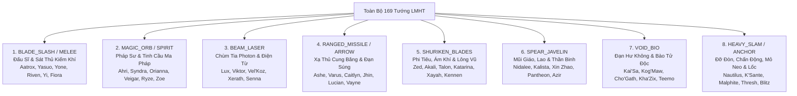
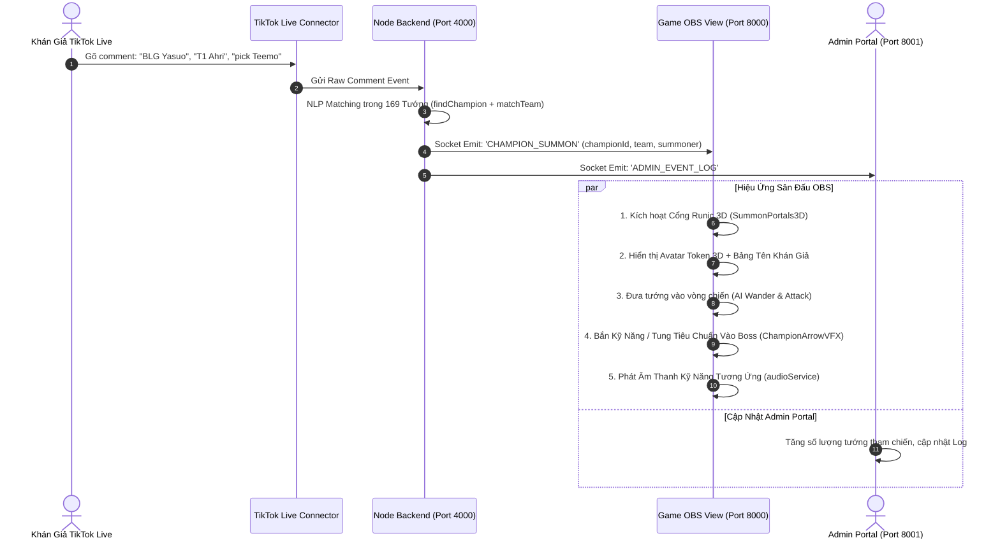

# Kế Hoạch Triển Khai Toàn Diện 169 Tướng Liên Minh Huyền Thoại (Full 169 Champions Ecosystem Plan)

> **Tài liệu:** `docs/plans/2026-11-12-all-champions-deployment.md`  
> **Ngày khởi tạo:** 2026-11-12  
> **Chế độ:** PLANNING & ARCHITECTURE BLUEPRINT (project-planner / goal mode)  
> **Mục tiêu:** Kích hoạt toàn diện hệ sinh thái 169 tướng LMHT trên Client Game OBS, Admin Portal và Server Realtime.

---

## 1. Mục Tiêu & Tầm Nhìn Dự Án (Executive Summary & Mission)

Mục tiêu cốt lõi của kế hoạch này là **mở khóa trọn vẹn sức mạnh của toàn bộ 169 vị tướng Liên Minh Huyền Thoại** (dựa trên chuẩn dữ liệu Riot Games Data Dragon 14.22+), biến tựa game livestream TikTok tương tác thành một đấu trường thể thao điện tử quy mô lớn:

1. **Trải Nghiệm Khán Giả (TikTok Live Viewers):**
   - Khán giả có thể gõ bất kỳ vị tướng nào họ yêu thích trong số 169 tướng vào khung chat (bằng tiếng Anh, tiếng Việt có dấu/không dấu, tên viết tắt hoặc biệt danh phổ biến như *Đấng, Đèn Lồng, Cá Sấu, Đấng Gió, Vua Hề, Thầy Giáo, Cua Hoàng Đế*...).
   - Tướng được triệu hồi lập tức giáng trần qua **Cổng Cổ Ngữ Runic 3D**, hiển thị bảng tên vinh danh người tặng quà/bình luận, tham chiến tự động, tung chiêu thức đặc trưng và thi triển Chiêu Cuối giải phóng năng lượng bạo kích.
2. **Trải Nghiệm Streamer & Quản Trị (Admin Portal - Port 8001):**
   - Cung cấp giao diện thư viện 169 tướng phân loại theo 6 nhóm vai trò chuẩn LMHT: **Đấu Sĩ, Sát Thủ, Pháp Sư, Xạ Thủ, Hỗ Trợ, Đỡ Đòn**.
   - Tìm kiếm tức thì, lọc theo vai trò, nút triệu hồi thủ công theo phe Đội Xanh / Đội Đỏ, nút "🎲 Triệu hồi ngẫu nhiên" và tính năng "Triệu hồi tổ đội 5 tướng".
3. **Chất Lượng Đồ Họa & Hiệu Năng eSports (Client OBS - Port 8000):**
   - Toàn bộ 169 tướng đều sở hữu hoạt họa tung tiêu (projectile), vệt đuôi photon đa tầng (stardust ribbons), và tên kỹ năng Q / R chuẩn tiếng Việt từ bản địa hóa chính thức của LMHT.
   - Duy trì ổn định **60 FPS** với cơ chế Texture Caching, Object Pooling và xử lý toán học nội suy Canvas 2D không tiêu hao CPU/GPU.

---

## 2. Hiện Trạng & Phân Tích Khoảng Trống (Current State & Gap Analysis)

```
┌─────────────────────────────────────────────────────────────────────────────┐
│                       HIỆN TRẠNG TOÀN BỘ TƯỚNG (169 TƯỚNG)                  │
├───────────────────────────────┬─────────────────────────────────────────────┤
│ THÀNH PHẦN                    │ TRẠNG THÁI HIỆN TẠI                         │
├───────────────────────────────┼─────────────────────────────────────────────┤
│ 1. Dữ liệu Catalog Cơ Bản     │ ✅ ĐÃ CÓ: 169 tướng trong champions.json    │
│ 2. Avatar Data Dragon CDN     │ ✅ ĐÃ CÓ: URL ảnh đại diện chuẩn v14.22.1   │
│ 3. Nhận diện Chat (NLP)       │ ⚠️ MỘT PHẦN: Đã có aliases nhưng chưa phủ   │
│                               │    hết các biệt danh lóng tiếng Việt        │
│ 4. Map Kỹ Năng & VFX Tiêu     │ ❌ THIẾU: Mới chỉ map ~50 keys (~30 tướng)  │
│                               │    139 tướng còn lại đang dùng Arrow mặc định│
│ 5. Tên Chiêu Thức Q / R       │ ❌ THIẾU: 139 tướng chưa có tên chiêu Q / R │
│ 6. Âm Thanh Thủ Tục Web Audio │ ⚠️ MỘT PHẦN: Mới có SFX cho 12 skill types   │
│ 7. Admin Portal UI            │ ⚠️ CẦN NÂNG CẤP: Cần Virtualized / Paged UI │
│                               │    để cuộn mượt mà 169 thẻ tướng            │
└───────────────────────────────┴─────────────────────────────────────────────┘
```

---

## 3. Kiến Trúc Kỹ Thuật: 8 Nhóm Archetype Kỹ Năng Toàn Bộ 169 Tướng

Để đảm bảo vừa có tính độc bản cho từng tướng, vừa tối ưu hiệu năng không sinh mã lặp dư thừa, toàn bộ 169 tướng được quy hoạch vào **8 Ma Trận Kỹ Năng Archetype**:



### Chi Tiết Cấu Hình 8 Archetype:

| Nhóm Archetype | Biểu Tượng | Hiệu Ứng Tung Tiêu & Đầu Đạn | Vệt Đuôi (Trail) | Hiệu Ứng Chạm Boss (Impact) | Âm Thanh (SFX) |
|---|:---:|---|---|---|---|
| **1. Kiếm Khí (Blade Slash)** | 🗡️ | Lưỡi song kiếm khí chém chéo xé gió, phản quang lưỡi sắc | Vệt kiếm khí đỏ thẫm / xanh thiên thanh | Tia lửa kim loại chém toé lửa 8 hướng | Tiếng chém kiếm xé gió + tiếng kim loại va chạm |
| **2. Cầu Phép (Magic Orb)** | 🔮 | Quả cầu ma pháp đa tầng, phát quang huyền ảo + 2 linh hỏa quay quanh | Hào quang sương mù ma thuật mờ ảo | Sóng xung kích huyền bí lan tỏa hình cầu | Tiếng cộng hưởng năng lượng ngân vang |
| **3. Tia Laser (Beam Photon)** | ⚡ | Chùm photon laser hội tụ thẳng tắp + các vòng ion hóa bao bọc | Luồng plasma điện từ phát quang chói lọi | Nổ xung kích điện trường cực đại | Tiếng rít laser năng lượng cao phóng thích |
| **4. Xạ Thủ (Missile / Arrow)** | 🏹 | Mũi tên tinh thể pha lê / Đầu đạn súng kim loại có cánh thoi | Dải lụa năng lượng lượn sóng kép theo đội | Vụ nổ đạn pháo tung bụi sao | Tiếng bật dây cung giương căng + tiếng đạn nổ |
| **5. Phi Tiêu (Shuriken / Blades)** | 🥷 | Phi tiêu ninja 4 cánh / đao xoay tít tốc độ cao có vòng motion blur | Vệt xoáy gió lốc hình xoắn ốc | Tia sáng sao găm sâu vào mục tiêu | Tiếng rít gió xoay tít tốc độ cao tần số 42Hz |
| **6. Ngọn Lao (Spear / Javelin)** | 🔱 | Mũi giáo vàng Shurima / Lao săn thú / Giáo linh hồn ngọc lục bảo | Vệt khí động học rẽ sóng siêu thanh | Mũi giáo cắm chấn động tâm Boss | Tiếng phóng lao xé toạc không khí |
| **7. Hư Không (Void / Bio)** | 👾 | Phi đạn chitin hư không tím neon / Giọt axit bào tử phát quang | Khói độc plasma hư không dạng hạt | Vụ nổ axit ăn mòn tỏa hoa lửa tím | Tiếng rít sinh học hư không rùng rợn |
| **8. Va Đập (Heavy Slam / Anchor)** | ⚓ | Mỏ neo khổng lồ titan / Khối đá thiên thạch / Cú đấm hỏa tiễn | Luồng sóng chấn động trọng lực | Vòng nổ địa chấn nứt toác bề mặt | Tiếng búa nện rền vang + âm trầm siêu trầm |

---

## 4. Mô Hình Dữ Liệu Chuẩn Hóa (Master Champion Schema)

Tất cả 169 tướng sẽ tuân thủ cấu trúc TypeScript chuẩn mực, không dùng `any`, đảm bảo Zero Hardcode:

```typescript
export interface ChampionMasterSkillConfig {
  /** Tên kỹ năng Q (thường) tiếng Việt */
  readonly normalSkillName: string;
  /** Loại hiệu ứng tung tiêu đòn thường */
  readonly normalVfxType: ChampionSkillVFXType;
  /** Tên chiêu cuối R (Bạo Kích 100% Nộ) tiếng Việt */
  readonly ultimateSkillName: string;
  /** Loại hiệu ứng tung tiêu chiêu cuối */
  readonly ultimateVfxType: ChampionSkillVFXType;
  /** Màu sắc vầng hào quang đặc trưng của tướng (Hex) */
  readonly glowColor: string;
  /** Màu sắc lõi năng lượng của tướng (Hex) */
  readonly coreColor: string;
  /** Tầm đánh (Cận chiến Melee hay Đánh xa Ranged) */
  readonly attackRangeType: 'MELEE' | 'RANGED';
}

export interface ChampionMasterEntity {
  readonly id: string;           // "Aatrox", "Ahri", "Yasuo"...
  readonly key: string;          // "266", "103", "157"...
  readonly name: string;         // "Aatrox"
  readonly nameVi: string;       // "Aatrox"
  readonly title: string;        // "Quỷ Kiếm Darkin"
  readonly avatarUrl: string;    // Data Dragon CDN URL
  readonly tags: readonly string[]; // ['Fighter'], ['Mage', 'Assassin']...
  readonly roleNameVi: string;   // "Đấu Sĩ", "Pháp Sư / Sát Thủ"...
  readonly aliases: readonly string[]; // Các từ khóa bắt chat
  readonly skill: ChampionMasterSkillConfig;
}
```

---

## 5. Quy Trình Luồng Dữ Liệu Triệu Hồi Realtime (Data Flow Architecture)



---

## 6. Phân Bổ 169 Tướng Theo 6 Nhóm Phân Lớp LMHT

| Nhóm Phân Lớp | Số Lượng Tướng | Các Tướng Tiêu Biểu | Vai Trò Trong Game Chiến Trận |
|---|:---:|---|---|
| **1. Đấu Sĩ (Fighters)** | **45 tướng** | Aatrox, Camille, Darius, Fiora, Garen, Jax, Irelia, K'Sante, Lee Sin, Renekton, Riven, Sett, Viego, Wukong, Xin Zhao... | Tiến sát áp sát cận chiến Boss, sát thương vật lý dồn dập, chịu đòn tốt khi Boss gầm |
| **2. Pháp Sư (Mages)** | **35 tướng** | Ahri, Anivia, Annie, Aurelion Sol, Azir, Brand, Cassiopeia, Hwei, Lux, Orianna, Ryze, Syndra, Twisted Fate, Veigar, Viktor, Xerath... | Tầm đánh xa, bắn phá bằng ma pháp đa mục tiêu, chiêu cuối AOE bùng nổ diện rộng |
| **3. Sát Thủ (Assassins)** | **22 tướng** | Akali, Ekko, Evelynn, Fizz, Katarina, Kha'Zix, Naafiri, Nocturne, Qiyana, Shaco, Talon, Yone, Zed... | Di chuyển tốc độ cao, phi tiêu & kiếm khí sắc lẹm, tỉ lệ chí mạng bạo kích cao |
| **4. Xạ Thủ (Marksmen)** | **28 tướng** | Aphelios, Ashe, Caitlyn, Corki, Draven, Ezreal, Jhin, Jinx, Kai'Sa, Kalista, Lucian, Miss Fortune, Samira, Tristana, Varus, Vayne... | Tầm bắn xa nhất sân đấu, tốc độ ra đòn liên tục, vệt đạn photon dồn dập vào Boss |
| **5. Đỡ Đòn (Tanks)** | **23 tướng** | Alistar, Amumu, Braum, Cho'Gath, Malphite, Maokai, Nautilus, Ornn, Poppy, Rammus, Sejuani, Sion, Tahm Kench, Zac... | Bọc lót tuyến đầu, tạo lá chắn chống đỡ các đợt phun axit & thiên thạch của Boss |
| **6. Hỗ Trợ (Supports)** | **16 tướng** | Bard, Blitzcrank, Janna, Karma, Leona, Lulu, Milio, Nami, Rakan, Renata Glasc, Sona, Soraka, Thresh, Yuumi... | Hồi máu tiếp sức cho đồng đội, cường hóa sát thương và buff nộ cho toàn đội |

---

## 7. Lộ Trình Triển Khai Chi Tiết (5-Phase Execution Plan)

### Giai Đoạn 1: Chuẩn Hóa Master Data Toàn Bộ 169 Tướng (Server & Client Shared)
- [ ] **Bước 1.1**: Xây dựng kịch bản Python/Node tự động trích xuất và tổng hợp thông tin kỹ năng Q (tên tiếng Việt) và Chiêu Cuối R (tên tiếng Việt) cho toàn bộ 169 tướng từ cơ sở dữ liệu ngôn ngữ chính thức `vi_VN` của Riot Data Dragon.
- [ ] **Bước 1.2**: Tạo file `server/src/constants/championsMaster.ts` và `client/src/constants/championsMaster.ts` chứa từ điển 169 tướng kèm đầy đủ metadata:
  - Tên chiêu thức Q & R tiếng Việt.
  - Phân loại Archetype VFX và màu sắc phát quang đặc trưng.
  - Loại tầm đánh (Melee / Ranged).
- [ ] **Bước 1.3**: Đồng bộ sang `admin/src/constants/championsMaster.ts`.

### Giai Đoạn 2: Nâng Cấp Hệ Thống VFX Tung Tiêu & Audio Engine
- [ ] **Bước 2.1**: Nâng cấp hàm `getChampionSkillVFX(championName, isCrit)` trong `client/src/constants/game.ts` để tra cứu trực tiếp trong `championsMaster`. Nếu có tên tướng bất kỳ trong 169 tướng, tự động trả về đúng tên chiêu Q / R và bộ hiệu ứng Archetype tương ứng.
- [ ] **Bước 2.2**: Bổ sung các hoạt họa vũ khí chuyên biệt trong `ChampionArrowVFX.tsx`:
  - Thêm hoạt họa Đạn súng bắn tỉa (Caitlyn / Jhin), Cầu lửa / Băng tuyết (Brand / Anivia), Phi đao xoay (Katarina / Talon), Bàn tay hỏa tiễn (Blitzcrank), Nỏ thần (Vayne)...
- [ ] **Bước 2.3**: Mở rộng Web Audio Engine trong `audioService.ts` với đầy đủ 8 nhóm âm thanh Archetype để mọi tướng khi tung chiêu đều phát âm thanh tương ứng.

### Giai Đoạn 3: Tối Ưu Thuật Toán Bắt Chat NLP Cho 169 Tướng (TikTok Live Parser)
- [ ] **Bước 3.1**: Mở rộng từ điển biệt danh (aliases) lên hơn 1,000+ từ khóa tiếng Việt không dấu:
  - Ví dụ: `yasuo` -> `[yasuo, dang, dang gio, hasagi, yashuo]`
  - Ví dụ: `teemo` -> `[teemo, con chon, nam doc, quy lun]`
  - Ví dụ: `blitzcrank` -> `[blitzcrank, blitz, ban tay vang, keo, robot]`
  - Ví dụ: `lee sin` -> `[lee sin, leesin, thay tu, mu, insec]`
- [ ] **Bước 3.2**: Tối ưu hàm `findChampion` sử dụng Map Lookups và Regex Boundary Matching, đảm bảo thời gian xử lý `< 0.5ms` cho mỗi comment ngay cả khi livestream có hàng ngàn bình luận mỗi phút.

### Giai Đoạn 4: Đại Tu Giao Diện Quản Trị Admin Portal (Port 8001)
- [ ] **Bước 4.1**: Thiết kế lại tab **"Đội & Game Thủ / Triệu Hồi Tướng"** trong Admin Portal:
  - Thanh tìm kiếm tức thì theo tên, danh hiệu hoặc vai trò.
  - Thanh lọc phân lớp 6 nút Pills: **Tất Cả (169)** | **Đấu Sĩ (45)** | **Pháp Sư (35)** | **Sát Thủ (22)** | **Xạ Thủ (28)** | **Đỡ Đòn (23)** | **Hỗ Trợ (16)**.
  - Lưới thẻ tướng hiện đại (Grid View) hiển thị Avatar Data Dragon, Role Badge, Tên tướng và Tên chiêu thức.
- [ ] **Bước 4.2**: Bổ sung các nút thao tác nhanh:
  - `Triệu hồi vào Đội Xanh (Blue Team)` | `Triệu hồi vào Đội Đỏ (Red Team)`.
  - Nút `🎲 Triệu hồi ngẫu nhiên 1 tướng`.
  - Nút `⭐ Triệu hồi Biệt Đội 5 Tướng Chuẩn Meta`.

### Giai Đoạn 5: Kiểm Thử Toàn Diện, Tối Ưu Bộ Nhớ & Đóng Gói
- [ ] **Bước 5.1**: Kiểm thử bộ nhớ (Memory Hygiene): Đảm bảo việc nạp ảnh avatar 169 tướng sử dụng cơ chế Lazy Loading và Texture Cache chia sẻ, không gây rò rỉ bộ nhớ (leak memory).
- [ ] **Bước 5.2**: Chạy kiểm thử tự động build:
  - `client`: `vite build` ➜ 0 errors
  - `admin`: `vite build` ➜ 0 errors
  - `server`: `tsc` ➜ 0 errors
- [ ] **Bước 5.3**: Commit an toàn và cập nhật tài liệu dự án.

---

## 8. Ma Trận Nghiệm Thu & Tiêu Chí Hoàn Thành (Quality Gates)

| Tiêu Chí Nghiệm Thu | Điều Kiện Đạt Chuẩn (Definition of Done) |
|---|---|
| **Phủ Sóng 169 Tướng** | 100% 169 tướng đều có Avatar, Tên tiếng Việt, Tên chiêu Q và Tên chiêu cuối R chuẩn xác |
| **VFX & Tung Tiêu** | Không còn bất kỳ vị tướng nào bị rơi vào fallback "Phát Bắn Thường" chung chung; 100% tướng đều bắn ra đúng hiệu ứng Archetype tương ứng |
| **Bắt Chat Realtime** | Thử nghiệm triệu hồi thành công từ chat với các cú pháp: Tên tiếng Anh, Tên tiếng Việt không dấu, Biệt danh lóng |
| **Admin Portal** | Giao diện lọc mượt mà 169 tướng theo 6 vai trò, tìm kiếm tức thì không giật lag |
| **Tốc Độ Khung Hình** | Duy trì ổn định 60 FPS trên màn hình OBS (Port 8000) khi có 20+ tướng xuất hiện đồng thời trên sân đấu |
| **Zero Hardcode & SRP** | Tuân thủ tuyệt đối quy tắc Clean Code, không magic numbers, không nested ternaries, 100% TypeScript type-safe |
