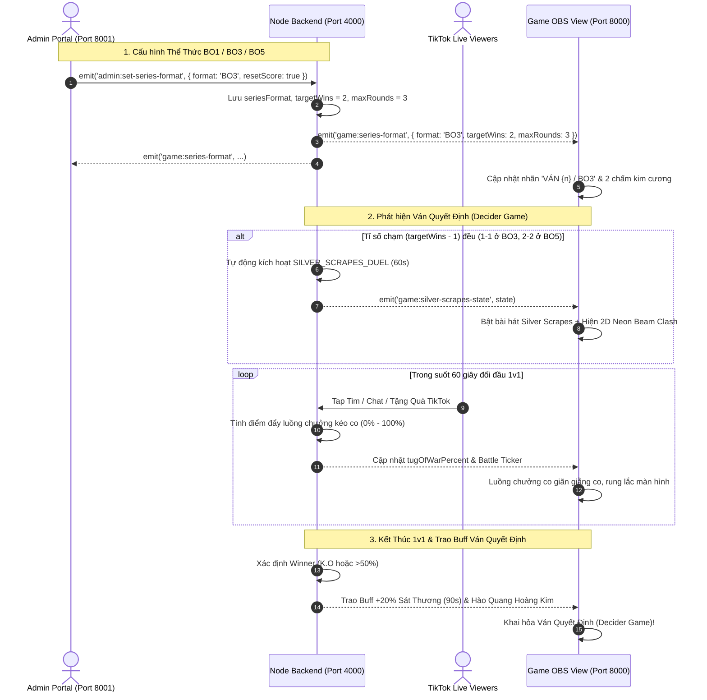

# Kế Hoạch Triển Khai: Cấu Hình Thể Thức BO1/BO3/BO5 & Đấu Trường Solo 1v1 Silver Scrapes

> **File:** `docs/plans/2026-11-12-silver-scrapes-duel.md`  
> **Ngày cập nhật:** 2026-11-12  
> **Chế độ:** PLANNING ONLY (No code writing in this phase)  
> **Trạng thái:** Đã bổ sung cấu hình BO1/BO3/BO5 & Chờ phê duyệt

---

## 1. Mục Tiêu & Bối Cảnh (Context & Goal)

1. **Cấu hình thể thức thi đấu linh hoạt (BO1 / BO3 / BO5):**
   - Hỗ trợ streamer tùy chỉnh độ dài trận đấu theo nhu cầu:
     - **BO1 (Best of 1):** 1 ván duy nhất (`targetWins = 1`, `maxRounds = 1`).
     - **BO3 (Best of 3):** Chạm 2 ván thắng (`targetWins = 2`, `maxRounds = 3`).
     - **BO5 (Best of 5):** Chạm 3 ván thắng (`targetWins = 3`, `maxRounds = 5`).
2. **Kích hoạt Đấu Trường Solo 1v1 "Silver Scrapes" theo công thức tổng quát:**
   - Khi trận đấu bước vào **Ván Đấu Quyết Định (Decider Game)**:
     $$\text{isDeciderGame} = (\text{Score}_A == \text{Score}_B) \land (\text{Score}_A == \text{targetWins} - 1)$$
     - Với **BO3**: Kích hoạt khi tỉ số hòa **1 - 1** (chuẩn bị Ván 3).
     - Với **BO5**: Kích hoạt khi tỉ số hòa **2 - 2** (chuẩn bị Ván 5).
     - Với **BO1**: Tùy chọn kích hoạt "Solo Khởi Động" (Warm-up First Blood Duel) trước trận.
3. **Mini-game 1v1 Kéo Co Năng Lượng (2D Neon Beam Clash - 60s):**
   - Hai tuyển thủ chủ chốt (mặc định Mid Lane) đối đầu trực diện.
   - Khán giả 2 phe Tap Tim, Chat và Donate Quà TikTok để giằng co luồng chưởng.
   - Phe thắng mang về bùa lợi **+20% Sát Thương toàn đội trong 90 giây đầu** của ván đấu quyết định.

---

## 2. Bảng Quy Chuẩn Thể Thức Thi Đấu (Series Format Specifications)

| Thể Thức | Số Ván Thắng (`targetWins`) | Số Ván Tối Đa (`maxRounds`) | Hiển Thị Nhãn Ván Đấu | Số Viên Ngọc / Kim Cương Tỉ Số | Điều Kiện Silver Scrapes 1v1 |
| :---: | :---: | :---: | :---: | :---: | :---: |
| **BO1** | **1 ván** | 1 ván | `VÁN 1 / BO1` | 1 chấm kim cương | *(Tùy chọn Warm-up trước trận)* |
| **BO3** | **2 ván** | 3 ván | `VÁN {n} / BO3` | 2 chấm kim cương | **Khi hòa 1 - 1 (Ván 3)** |
| **BO5** | **3 ván** | 5 ván | `VÁN {n} / BO5` | 3 chấm kim cương | **Khi hòa 2 - 2 (Ván 5)** |

---

## 3. Kiến Trúc Hệ Thống & Luồng Dữ Liệu (Architecture & Data Flow)

---

## 4. Phân Kỳ Triển Khai (Phased Implementation Breakdown)

### 📌 Giai Đoạn 1: Backend Server (Series Format & Duel Engine)
- **Tập tin tác động:** `server/src/index.ts`
- **Nhiệm vụ:**
  1. Thêm State Thể Thức:
     - `seriesFormat: 'BO1' | 'BO3' | 'BO5'` (mặc định `'BO5'`).
     - `targetWins: 1 | 2 | 3`.
     - `maxRounds: 1 | 3 | 5`.
  2. Sự kiện Socket Thể Thức:
     - `admin:set-series-format`: Nhận `{ format, resetScore }` -> Lưu disk persistence `server/data/series_format.json` và phát broadcast `game:series-format`.
     - Tự động clamp tỉ số hiện tại không vượt quá `targetWins`.
  3. Quản lý State Silver Scrapes Duel (`SilverScrapesDuelState`):
     - `isActive`, `timeRemaining` (60s loop tick 100ms), `tugOfWarPercent`, `selectedLane`, `leftPlayer`, `rightPlayer`, `winner`, `buffActiveUntil`.
     - Tự động kiểm tra điều kiện Decider Game khi cập nhật tỉ số:
       `score.BLG === score.GENG && score.BLG === targetWins - 1` -> Kích hoạt 1v1.
  4. Bộ quy đổi tương tác:
     - **Tap Tim:** +0.2% mỗi 20 tim.
     - **Chat từ khóa:** +0.8%.
     - **Quà 1-10 xu:** +3.0%.
     - **Quà 50-199 xu:** +10.0%.
     - **Quà 1,000+ xu:** +25.0%.
     - Cơ chế "Lá Chắn Tử Thủ" (giới hạn 95% trong 15s đầu tránh K.O sớm).

---

### 📌 Giai Đoạn 2: Client State, Âm Thanh & Bảng Tỉ Số
- **Tập tin tác động:**
  - `client/src/types/game.ts`
  - `client/src/constants/game.ts`
  - `client/src/store/gameStore.ts`
  - `client/src/components/ui/TeamScoreBoard.tsx`
  - `client/src/components/ui/VictoryOverlay.tsx`
  - `client/src/services/audioService.ts`
- **Nhiệm vụ:**
  1. Thêm `seriesFormat`, `targetWins`, `maxRounds` và `silverScrapesState` vào `gameStore.ts`.
  2. Cập nhật `TeamScoreBoard.tsx`:
     - Nhãn ván đấu hiển thị: `VÁN {currentRound} / {seriesFormat}`.
     - Số chấm tròn/kim cương tỉ số render động theo `Array.from({ length: targetWins })` (1 chấm cho BO1, 2 chấm cho BO3, 3 chấm cho BO5).
  3. Cập nhật `VictoryOverlay.tsx`:
     - Nhận diện kết thúc loạt trận khi một bên đạt `targetWins`.
     - Text vinh danh: `🏆 {team} VÔ ĐỊCH {seriesFormat}! ({scoreBLG} - {scoreGENG})`.
  4. Cập nhật `audioService.ts`:
     - Tích hợp bài hát *Silver Scrapes* (dạo beat tự động khi duel bắt đầu, tự tắt khi ván đấu mở màn).
     - Hiệu ứng âm thanh chưởng va chạm (`playLaserClashSound()`, `playUltimateClashSound()`).

---

### 📌 Giai Đoạn 3: Giao Diện Game OBS (2D Neon Beam Clash Overlay)
- **Tập tin tạo mới:** `client/src/components/ui/SilverScrapesDuelOverlay.tsx`
- **Tập tin cập nhật:** `client/src/components/ui/HUDOverlay.tsx`
- **Nhiệm vụ:**
  1. Thiết kế Overlay 2D Neon Beam Clash co giãn chuẩn tỉ lệ 9:16 mobile / OBS:
     - **Header:** `⚡ SILVER SCRAPES: ĐẠI CHIẾN ĐỘC TÔN 1V1 ⚡` + Đồng hồ đếm lùi `00:58s`.
     - **Khu Vực Va Chạm Luồng Sáng:**
       - Avatar tuyển thủ 2 bên bốc lửa nộ (Cyan bên trái, Gold bên phải).
       - Luồng năng lượng cực đại bắn từ 2 phía chạm nhau ở điểm trung tâm, co giãn theo `tugOfWarPercent`.
       - Điểm giao nhau có vụ nổ Plasma phát sáng liên tục và hiệu ứng rung chấn màn hình (Screen Shake) khi có quà lớn.
     - **Thanh Kéo Co Tỉ Lệ Thực:** `[BLG 58%] ◄ [ ⚔️ ] ► [42% GEN]`.
     - **Dòng Tin Chiến Tích:** Tên người xem vừa nổ quà/chat kèm hiệu ứng chiêu thức.
     - **Màn K.O & Vinh Danh:** Hiển thị kết quả thắng/thua, trao Buff +20% Sát thương toàn đội trong 90s ván quyết định.

---

### 📌 Giai Đoạn 4: Bảng Điều Khiển Admin Portal
- **Tập tin tạo mới:** `admin/src/components/SilverScrapesControls.tsx`
- **Tập tin cập nhật:** `admin/src/App.tsx`, `admin/src/constants/tabs.ts`
- **Nhiệm vụ:**
  1. **Bộ Chọn Thể Thức (Format Selector):**
     - Nút chuyển nhanh: `[ BO1 ] | [ BO3 ] | [ BO5 ]`.
     - Cập nhật tự động số điểm tối đa của các nút tăng điểm (+1 BLG, +1 GEN.G).
     - Checkbox tùy chọn: *"Reset điểm về 0 - 0 khi đổi thể thức"*.
  2. **Bảng Điều Khiển Silver Scrapes 1v1:**
     - Nút **[Bắt Đầu 1v1 (60s)]**, **[Dừng Khẩn Cấp]**, **[+30s Bù Giờ]**.
     - Dropdown chọn cặp đấu:
       - `Đường Giữa (Mid Lane)` *(Mặc định)*
       - `Đường Trên (Top Lane)`
       - `Đi Rừng (Jungle)`
       - `Xạ Thủ (ADC)`
       - `Hỗ Trợ (Support)`
     - Thanh kéo co hiển thị tỉ số % giằng co realtime.

---

### 📌 Giai Đoạn 5: Kiểm Thử, Tối Ưu Hóa & Rà Soát Chất Lượng
- **Kiểm thử thể thức (Format Testing):**
  - Chuyển sang **BO1**: Kiểm tra ván 1 thắng là kết thúc cả trận ngay.
  - Chuyển sang **BO3**: Kiểm tra hòa 1 - 1 tự động kích hoạt Silver Scrapes Ván 3.
  - Chuyển sang **BO5**: Kiểm tra hòa 2 - 2 tự động kích hoạt Silver Scrapes Ván 5.
- **Kiểm thử tương tác 1v1:**
  - Bấm Tap tim, Chat từ khóa, Tặng quà xu nhỏ và xu to -> Kiểm tra thanh kéo co di chuyển chuẩn xác.
  - Kiểm tra K.O chớp nhoáng (100%) và kết thúc tính điểm sau 60s.
  - Kiểm tra bùa lợi +20% Sát Thương hoạt động chuẩn xác trong 90s đầu của ván quyết định.
- **Kiểm tra Monorepo Build:**
  - Chạy `npm run build:all` đảm bảo 100% Pass và 0 lỗi TypeScript/bundle.

---

## 5. Danh Sách Kiểm Tra Hoàn Thành (Verification Checklist)

- [ ] Cấu hình `seriesFormat` (BO1/BO3/BO5) chuyển đổi mượt mà giữa Admin, Server và Client.
- [ ] Bảng tỉ số Game View tự động đổi số chấm kim cương (1 cho BO1, 2 cho BO3, 3 cho BO5).
- [ ] Tự động kích hoạt Silver Scrapes khi chạm ván quyết định (1-1 ở BO3, 2-2 ở BO5).
- [ ] Luồng chưởng 2D Neon Beam Clash hiển thị mượt mà 60fps, co giãn theo tương tác kéo co.
- [ ] Admin Portal có đầy đủ bộ chọn thể thức BO1/BO3/BO5 và nút can thiệp 1v1.
- [ ] Bùa lợi +20% Sát thương kích hoạt đúng 90 giây ở ván quyết định.
- [ ] `npm run build:all` thành công 100% với 0 lỗi.
