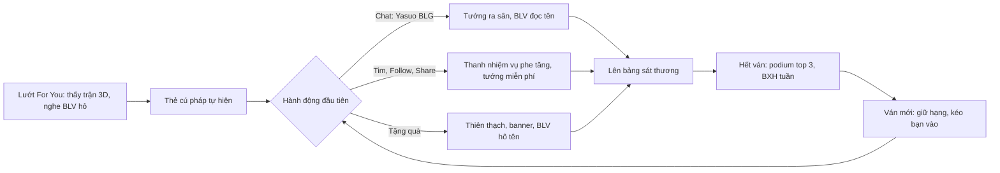
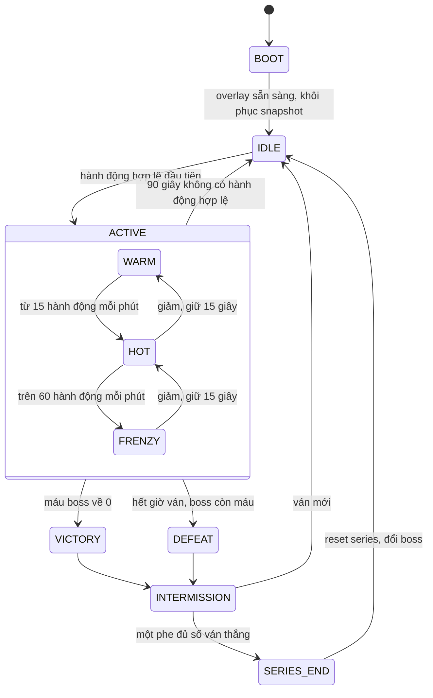
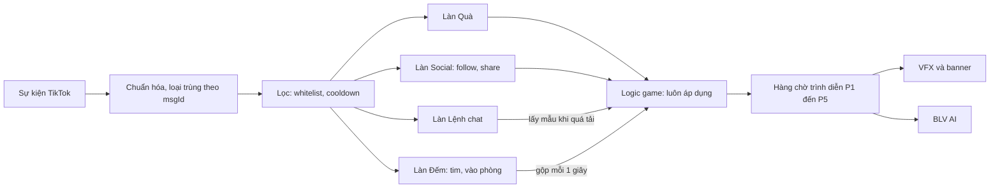

# LoL CKTG Live Interactive Game · BLG vs Gen.G

Đặc tả nghiệp vụ và logic vận hành cho phòng live TikTok chạy 24/7 không người dẫn. BLV AI dẫn trận. Người xem chat để triệu hồi tướng và tặng quà để đánh boss. Tài liệu bám theo hệ thống đang có trong repo và đánh dấu rõ phần nào đã chạy, phần nào cần chỉnh, phần nào phải làm mới. Tài liệu không có mã nguồn.

**Hiện trạng:** `ĐÃ CÓ` đã chạy trong code · `CẦN CHỈNH` có nhưng chưa đủ cho chế độ tự động · `MỚI` chưa có, cần làm.

---

## 00 · Tổng quan & thuật ngữ

Màn hình live là overlay dọc 9:16 trong OBS. Boss 2D đứng giữa sân. Tướng 3D của hai phe BLG và Gen.G lao vào đánh. Khi boss hết máu, phe gây nhiều sát thương hơn thắng ván. Ván nằm trong một series BO1, BO3 hoặc BO5. Thắng series thì phe đó nhận thêm một danh hiệu vô địch.

Mục tiêu của chế độ **No Host**: không ai cần ngồi trực. Mọi phản hồi (hình, tiếng, lời BLV) đều do hệ thống tự sinh từ sự kiện TikTok và trạng thái trận đấu.

> **Ba nguyên tắc nền**
> - **Tiền không bao giờ bị chặn.** Quà luôn được tính vào logic game, kể cả khi hệ thống quá tải. Chỉ phần trình diễn (giọng đọc, banner) được gộp hoặc rút gọn.
> - **BLV không bao giờ đọc nguyên văn chat.** Giọng đọc chỉ ghép mẫu câu có sẵn với tên đã lọc và từ khóa nằm trong whitelist.
> - **Phòng không bao giờ im lặng.** Khi không có tương tác, hệ thống tự chuyển sang chế độ Chờ có kịch bản giữ nhiệt.

### Thuật ngữ

| Thuật ngữ | Nghĩa trong tài liệu | Tên trong code (nếu có) |
|---|---|---|
| Lệnh triệu hồi | Chat có tên tướng và/hoặc tên phe, ví dụ `Yasuo BLG`, `GEN`, `random` | `parseCommentCommand` |
| Phe đã khóa | Phe gắn với một tài khoản sau lần chọn đầu tiên, giữ 4 giờ | `AFFINITY_TTL_MS` |
| Lượt ra sân | Nhịp đưa tướng vào sân: tối đa N tướng mỗi phe mỗi lượt, cách nhau một khoảng trễ | `maxDeployPerTurn`, `summonTurnDelayMs` |
| Ván / Series | Ván kết thúc khi boss hết máu. Series là chuỗi BO1/BO3/BO5 | `bo5Score`, `bo5TargetWins` |
| Coin | Giá trị kim cương của một quà TikTok, lấy từ sự kiện, không dùng bảng giá tĩnh | `diamondCount` |
| Cấp quà | SMALL / MEDIUM / BIG / MEGA, xác định theo coin của quà và tổng chuỗi | `resolveGiftTier` |
| Fury | Thanh cuồng nộ của tướng pro, đầy thì tung chiêu cuối | `combatSlice` |
| Auto Pro Battle | 10 tuyển thủ pro của hai đội tự đánh boss, có tùy chọn chỉ chạy khi sân trống | `autoProBattleConfig.onlyWhenIdle` |
| Hàng chờ trình diễn | Hàng đợi ưu tiên P1–P5 cho giọng BLV và banner. Tách khỏi logic game | Chưa có |

---

## 01 · Hành trình người xem & luồng tương tác

Người xem TikTok quyết định ở lại hay lướt đi trong khoảng 3 giây. Hành trình được thiết kế để có hành động đầu tiên trong 15 giây và có phản hồi mang tên họ trong vòng 2 giây sau đó.

| Giai đoạn | Thời điểm | Người xem thấy / nghe | Hệ thống làm gì | Chỉ số theo dõi | Hiện trạng |
|---|---|---|---|---|---|
| 1. Lướt vào | 0–3 s | Sân 3D đang đánh nhau, máu boss, tỉ số BO, giọng BLV đang hô | Luôn có chuyển động trên sân. Phòng vắng thì 10 tuyển thủ pro tự đánh boss (Auto Pro Battle, mục 3) | Tỉ lệ ở lại quá 10 s | `CẦN CHỈNH` |
| 2. Hiểu luật | 3–15 s | Thẻ cú pháp: “Gõ tên tướng + BLG/GEN”. BLV đọc ví dụ cụ thể | Thẻ hướng dẫn tự hiện theo chu kỳ. BLV chào gộp người mới vào phòng mỗi 30 s | % người xem gửi lệnh đầu tiên | `ĐÃ CÓ` thẻ · `MỚI` chào gộp |
| 3. Hành động đầu | ≤ 15 s | Gõ `Ahri GEN`, thả tim, follow hoặc share | Phân tích lệnh, khóa phe, đưa vào hàng ra sân, báo “Lượt #N” | Thời gian đến hành động đầu | `ĐÃ CÓ` |
| 4. Phản hồi tức thì | ≤ 1,5 s hình · ≤ 3 s tiếng | Tướng của mình ra sân có gắn tên. BLV đọc tên và tướng | Logic áp dụng ngay. Giọng đọc qua hàng chờ ưu tiên | Độ trễ p95 từ sự kiện đến hiển thị | `CẦN CHỈNH` TTS |
| 5. Leo thang | ván 1–3 | Thấy người khác tặng quà, thiên thạch rơi, boss choáng, tên lên bảng DPS | Hiệu ứng theo cấp quà. BLV khen đích danh. Nhiệm vụ cộng đồng gần đầy | Tỉ lệ chuyển đổi sang quà đầu tiên | `ĐÃ CÓ` |
| 6. Được ghi nhận | cuối ván | Podium top 3, MVP, BXH tuần/tháng | Gửi kết quả ván lên server, cộng hồ sơ người chơi | Số người có tên trên podium | `ĐÃ CÓ` |
| 7. Quay lại | ván sau, ngày sau | “Top 1 tuần vẫn là bạn, giữ ngôi nhé” | BLV nhắc hạng tuần trong lúc giữ nhiệt | Tỉ lệ người xem quay lại trong 7 ngày | `MỚI` |

Mốc thời gian là mục tiêu thiết kế. Đo bằng log server (thời điểm nhận sự kiện) và log overlay (thời điểm hiển thị, thời điểm bắt đầu đọc).

---

## 02 · Ma trận quy tắc nghiệp vụ & giới hạn

Mọi con số dưới đây là tham số cấu hình, chỉnh được từ admin, không viết cứng. Tên tham số đề xuất ghi ở cột cuối.

### 2.1 Chống spam (cooldown)

| Hành động | Giới hạn | Khi vượt giới hạn | Hiện trạng | Tham số |
|---|---|---|---|---|
| Lệnh triệu hồi hợp lệ | 1 lệnh / 6 s / tài khoản | Bỏ qua im lặng. Không đọc tên, không báo lỗi công khai | `MỚI` | `SUMMON_CHAT_COOLDOWN_MS = 6000` |
| Trần theo phút | 8 lệnh / 60 s / tài khoản | Như trên. Đếm theo cửa sổ trượt | `MỚI` | `SUMMON_CHAT_MAX_PER_MINUTE = 8` |
| Lặp cùng tướng | 1 lần / 30 s / tài khoản / tướng | Chỉ lần đầu được tính | `MỚI` | `SAME_CHAMPION_REPEAT_MS = 30000` |
| Spam liên tục | ≥ 15 tin bị chặn trong 60 s | Tắt tiếng mềm 5 phút: game bỏ qua lệnh, BLV không đọc tên. Người đó không bị thông báo | `MỚI` | `SOFT_MUTE_TRIGGER = 15`, `SOFT_MUTE_MS = 300000` |
| Thả tim | tối đa 15 tim / sự kiện | Phần dư bị cắt. Không đọc tên người thả tim, chỉ đọc mốc nhiệm vụ | `ĐÃ CÓ` | `MAX_LIKE_BATCH_CLAMP` |
| Follow | 1 lần / tài khoản | Follow lại không có thưởng (tính là chặn spam) | `ĐÃ CÓ` | `MAX_FOLLOW_HISTORY = 8000` |
| Share | 1 lần / 15 s / tài khoản | Không có sát thương và không đọc tên | `ĐÃ CÓ` | `SHARE_COOLDOWN_MS` |
| Quà tặng | Không giới hạn trong logic | Luôn tính. Chỉ giới hạn giọng đọc: quà SMALL/MEDIUM của cùng một người đọc tối đa 1 lần / 20 s, phần còn lại gộp | `CẦN CHỈNH` | `GIFT_SHOUTOUT_COOLDOWN_MS = 20000` |
| Toàn phòng | ≤ 1 câu P4 / 4 s | Câu P4 thừa được gộp thành “… và N người khác” | `MỚI` | `LOW_PRIORITY_LINE_GAP_MS = 4000` |

> **Vì sao chặn im lặng:** nếu BLV nói “Bạn đang spam”, người spam có được sự chú ý mà họ muốn và phòng bị kéo vào tranh cãi. Chặn im lặng làm hành vi spam không còn tác dụng.

### 2.2 Bộ lọc nội dung

Chat đi qua bốn lớp theo thứ tự. Lớp sau chỉ nhận dữ liệu lớp trước đã cho qua.

1. **Chuẩn hóa.** Đưa về Unicode NFC và chữ thường. Tạo một bản không dấu để so khớp. Gộp ký tự lặp (“gaaank” → “gank”). Đổi ký tự lách luật (`0→o`, `1→i`, `3→e`, `@→a`, `$→s`). Bỏ dấu chấm và khoảng trắng chen giữa chữ.
2. **Whitelist lệnh.** Chỉ các token khớp danh sách mới vào game: từ khóa phe (`BLG`, `GEN`, `GENG`, `GEN.G` và shortTag của đội đang chơi), tên tướng và biệt danh trong `champions.json`, `random` / `ngẫu nhiên`. Phần còn lại của câu chat bị bỏ qua. `ĐÃ CÓ` phần khớp tên. `MỚI` bảng biệt danh, ví dụ “mf” → Miss Fortune.
3. **Blacklist cho tên hiển thị và giọng đọc.** Từ tục tiếng Việt và tiếng Anh, xúc phạm vùng miền hoặc sắc tộc, chính trị, tình dục, ma túy, cờ bạc, số điện thoại, URL, @handle, tên kênh khác, mã giảm giá. Danh sách cập nhật nóng từ admin, không cần khởi động lại. `MỚI`
4. **Làm sạch tên để đọc.** Tối đa 16 ký tự hoặc 3 từ. Bỏ emoji, ký tự lạ, dãy số từ 4 chữ số trở lên. Tên dính blacklist hoặc thành rỗng sau khi lọc thì đọc bí danh “một chiến binh BLG” và hiển thị tên dạng che “Ng***”. `CẦN CHỈNH` (`sanitizeSpeechText` mới bỏ số và dấu gạch dưới)

> **Quy tắc vàng của giọng đọc:** câu BLV = **mẫu câu đã duyệt** + **tên đã lọc** + **token trong whitelist** (tướng, phe, tên quà, số). Không có đường nào để chữ người xem tự gõ đi thẳng vào TTS. Đây là lớp chặn quan trọng nhất khi phòng chạy không người trực.

### 2.3 Phân cấp quà tặng

Ngưỡng cấp quà lấy từ `GIFT_TIER_CONFIG` hiện có. Với chuỗi quà (combo), cấp chỉ được nâng một lần ở đúng lượt mà tổng chuỗi vượt ngưỡng. Các lượt sau quay về cấp của quà lẻ, nên banner MEGA và hiệu ứng boss choáng không lặp lại ở mỗi lượt.

| Cấp | Coin | Ví dụ quà* | Hệ số sát thương | Hình ảnh | Âm thanh & giọng đọc | Hiện trạng |
|---|---|---|---|---|---|---|
| SMALL | 1–9 | Rose (1), Finger Heart (5) | × 1,0 | Pill nhỏ cạnh tên, không thiên thạch | P4, gộp theo chuỗi, đọc khi chuỗi kết thúc | `ĐÃ CÓ` hình |
| MEDIUM | 10–98 | Doughnut (30) | × 1,2 | 3 thiên thạch, rung 0,45, banner 2,5 s | P3, đọc tên + tên quà | `ĐÃ CÓ` hình |
| BIG | 99–999 | Hand Hearts (100) | × 1,5 | 8 thiên thạch, chớp màn hình, banner 4,5 s | P2, chen lên đầu hàng chờ, nhạc nền giảm 6 dB | `ĐÃ CÓ` hình |
| MEGA | 1.000–9.999 | Galaxy (1.000) | × 2,0 | 16 thiên thạch, boss choáng 1,8 s, banner 6,5 s | P1, ngắt câu đang đọc, nhạc giảm 12 dB, đoạn hô riêng | `ĐÃ CÓ` hình |
| LEGENDARY | ≥ 10.000 | Lion (29.999), Universe (34.999) | × 2,5 | Chiếm toàn màn hình 10 s, tên vào Sảnh danh vọng trong ngày | P1, kịch bản riêng, chạy hết mới tiếp tục | `MỚI` |

\* Giá quà do TikTok quy định và có thể khác theo khu vực. Hệ thống luôn dùng `diamondCount` trong sự kiện. Hệ số sát thương là đề xuất mới, cần cân bằng với HP boss của từng theme (kế hoạch VFX ngày 13/11 đã chốt MEGA giữ × 1, xem quyết định D3 trong plan).

- **Trần sát thương mỗi quà** `MỚI`: một quà trừ tối đa 35% máu tối đa của boss (`GIFT_MAX_BOSS_HP_RATIO = 0.35`). Toàn bộ giá trị quà vẫn cộng vào điểm phe và bảng cá nhân. Như vậy một quà lớn không kết thúc ván ngay lập tức, mà người tặng vẫn nhận đủ công.
- **Hòa điểm khi boss chết** `CẦN CHỈNH`: hiện tại phe BLG thắng khi hai phe bằng điểm (`newBLGScore >= newGENGScore` trong `combatSlice.ts`). Đề xuất: hòa thì phe ra đòn kết liễu thắng. Cách này công bằng hơn và tạo khoảnh khắc “last hit” cho BLV hô.

### 2.4 Thang ưu tiên âm thanh

| Mức | Nội dung | Hành vi trong hàng chờ | Hạn sống (TTL) | Độ dài câu tối đa |
|---|---|---|---|---|
| P1 | Kết quả ván và series, quà MEGA và LEGENDARY | Ngắt câu đang đọc (trừ một câu P1 khác) | 30 s | 8 s |
| P2 | Quà BIG, boss nổi điên, đòn kết liễu, đổi top 1 DPS | Chen lên đầu hàng, không ngắt | 15 s | 5 s |
| P3 | Quà MEDIUM, follow, share, người chơi mới lần đầu | Xếp theo thứ tự đến | 10 s | 4 s |
| P4 | Triệu hồi thường, chuỗi quà SMALL | Gộp theo phe, giãn ≥ 4 s | 6 s | 2,5 s |
| P5 | Giữ nhiệt (banter) | Chỉ phát khi hàng chờ trống ≥ 8 s | không xếp hàng | 6 s |

Hiện tại hàng chờ TTS giữ tối đa 3 câu và bỏ câu cũ nhất (`TTS_CONSTANTS.MAX_QUEUE`), không có ưu tiên `CẦN CHỈNH`. Câu quá TTL bị bỏ vì đọc trễ về một sự kiện đã qua còn tệ hơn không đọc.

---

## 03 · Sơ đồ trạng thái hệ thống

Ba trạng thái chính luân phiên: Chờ, Giao tranh, Kết thúc. BOOT và INTERMISSION là trạng thái chuyển tiếp. Mất kết nối TikTok là một cờ chạy song song, không phải một trạng thái riêng (mục 6).

### 3.1 Trạng thái Chờ (IDLE)

**Vào khi:** 90 giây không có hành động hợp lệ (`IDLE_ENTER_MS = 90000`), hoặc sau khi một ván mới bắt đầu. Like lẻ tẻ không tính, trừ khi đạt 20 tim trong 10 giây. **Đồng hồ ván dừng** khi đang Chờ, nên phòng vắng không tự thua.

| Cấp chờ | Thời gian chờ | Hình ảnh | BLV | Cơ chế giữ chân | Hiện trạng |
|---|---|---|---|---|---|
| Chờ 1 · Mời gọi | 90 s – 5 phút | Boss làm động tác khiêu khích. Thẻ cú pháp hiện theo chu kỳ. BXH tuần xoay vòng | Giữ nhiệt mỗi 25–40 s, thiên về hướng dẫn | Ai hành động đầu tiên thành **Người phá băng**: sát thương × 2 trong 10 s, BLV hô riêng | `ĐÃ CÓ` thẻ · `MỚI` phá băng |
| Chờ 2 · Tạo áp lực | 5 – 20 phút | Auto Pro Battle bật: 10 tuyển thủ pro của hai đội tự đánh boss, sát thương giảm còn 30% để ván không tự kết thúc khi phòng vắng | Mỗi 30–45 s. Khích fan vào hỗ trợ tuyển thủ | Sân luôn có chuyển động. Tuyển thủ pro là nhân vật của game, không giả làm người xem | `ĐÃ CÓ` Auto Pro · `MỚI` giảm sát thương |
| Chờ 3 · Tiết kiệm | > 20 phút | Giảm hiệu ứng, nhạc nền ambient, Auto Pro thưa hơn | Mỗi 60–90 s | Giữ máy ổn định khi chạy dài. Hệ thống không bao giờ tự tắt live | `MỚI` |

> **Ranh giới đạo đức:** không bao giờ tạo tướng mang tên giả trông như người xem thật. Giả lập người xem để kích donate là gây hiểu lầm và có rủi ro vi phạm chính sách TikTok. Giữ nhiệt bằng nhân vật của game (tuyển thủ pro, boss), không bằng người xem giả.

### 3.2 Trạng thái Giao tranh (ACTIVE)

**Vào khi:** có một hành động hợp lệ (lệnh triệu hồi, quà, follow, share). Ba mức cường độ đo bằng số hành động hợp lệ mỗi phút, tính theo cửa sổ trượt. Hạ mức cần giữ ổn định 15 giây để tránh nhảy qua lại.

| Mức | Hành động / phút | Nhịp BLV | Trình diễn | Nhạc nền |
|---|---|---|---|---|
| WARM | < 15 | Đọc tên từng người. Chen giữ nhiệt nếu trống ≥ 8 s | Banner đầy đủ cho từng tướng | Lớp nền |
| HOT | 15 – 60 | P4 gộp theo phe: “A, B và 4 người nữa vào sân cho BLG” | Banner gộp, giới hạn VFX như hiện tại | Thêm lớp trống |
| FRENZY | > 60 | Chỉ đọc P1–P3. Câu hype chung mỗi 20 s: “Chat đang bùng nổ!” | Chỉ banner cho quà ≥ MEDIUM. Số sát thương gộp | Lớp cao trào |

**Quy chế khi bị dồn dập:** logic game không đổi theo mức cường độ. Mỗi lệnh hợp lệ vẫn vào hàng ra sân theo `maxDeployPerTurn` và `summonTurnDelayMs`. Chỉ phần trình diễn co giãn. Các mốc kịch tính có câu riêng: boss xuống dưới ngưỡng nổi điên (30–40% tùy boss, `enrageThreshold`), boss dưới 10% máu, đổi top 1 DPS, một phe lội ngược dòng.

### 3.3 Trạng thái Kết thúc (VICTORY / DEFEAT)

**VICTORY: boss bị hạ** `ĐÃ CÓ`
- Phe nhiều điểm hơn được +1 ván. Hòa thì xử lý theo mục 2.3.
- Dọn VFX, boss diễn cảnh gục, podium top 3 và MVP.
- Gửi `game:round-result` (top 50 sát thương) lên server để cộng BXH tuần, tháng, mọi thời đại.
- BLV đọc P1: phe thắng, MVP, sát thương của MVP.

**DEFEAT: boss sống sót** `MỚI`
- Đồng hồ ván chỉ chạy khi đang ACTIVE (đề xuất 6 phút, `ROUND_TIME_LIMIT_MS`). Hết giờ mà boss còn máu thì “Boss trốn thoát”.
- Không phe nào được điểm. Ván không tính vào tỉ số BO.
- Podium vẫn hiện để người chơi được ghi nhận.
- BLV đọc câu khích: “Lần sau phải đông hơn nữa!”

**Chu trình reset**
1. **INTERMISSION 12 s:** podium, BXH tuần, nhắc cú pháp. Snapshot trận được lưu ngay (`lol_match_snapshot_v1`).
2. **Nếu một phe đủ số ván thắng → SERIES_END 25 s:** màn hình vô địch, +1 danh hiệu cho cặp đội đó (lưu localStorage theo cặp team-id), BLV đọc kịch bản vô địch.
3. **Ván mới:** boss hồi đầy máu, thẻ giới thiệu ván hiện ra. Sau series thì đổi theme boss theo vòng. Phe đã khóa của người xem giữ nguyên.
4. **Vào IDLE** rồi chờ hành động đầu tiên để sang ACTIVE.

---

## 04 · Ma trận sự kiện & phản hồi

Mỗi hàng là một hợp đồng: hành động X tạo ra hình Y và câu thoại Z. Câu thoại là một biến thể mẫu; kho biến thể ở mục 5. `{name}` luôn là tên đã lọc.

| Hành động / sự kiện | Điều kiện | Hình ảnh & hiệu ứng | Âm thanh | BLV AI nói | Ưu tiên | Hiện trạng |
|---|---|---|---|---|---|---|
| Vào phòng | Gộp mỗi 30 s, ≥ 3 người | Dòng chào nhỏ ở góc | — | “Chào {n} chiến binh mới! Gõ BLG hoặc GEN để chọn phe!” | P5 | `MỚI` |
| Chat tướng + phe (`Yasuo BLG`) | Qua cooldown và whitelist | Tướng ra sân có tên, báo “Lượt #N” | SFX ra sân | “{name} tung {champion} vào sân cho {team}!” | P4 | `CẦN CHỈNH` TTS |
| Chat chỉ có phe (`GEN`) | Cho phép triệu hồi chỉ bằng phe | Tướng ngẫu nhiên của phe | SFX ra sân | “{name} gia nhập {team}! Tướng bí ẩn đang xuống đường!” | P4 | `ĐÃ CÓ` logic |
| Chat ngẫu nhiên (`random`) | — | Hiệu ứng quay số trên tên tướng | Tiếng quay số | “Quay số… {name} nhận được {champion}!” | P4 | `ĐÃ CÓ` logic |
| Chat sai cú pháp | Cùng người sai 3 lần trong 2 phút | Thẻ cú pháp hiện lên, không có tên người | — | Không nói | — | `MỚI` |
| Chat trong cooldown / bị tắt tiếng | — | Không có | — | Không nói | — | `MỚI` |
| Người chơi mới | Lệnh hợp lệ đầu tiên trong ngày | Viền sáng cho tướng, nhãn “Tân binh” | SFX nhấn | “Tân binh {name} ra mắt với {champion}!” | P3 | `MỚI` |
| Thả tim | Theo lô, tối đa 15 tim | Thanh nhiệm vụ tim của phe tăng | — | Chỉ nói khi đạt mốc: “{team} đủ tim! Fury đầy cho cả đội pro!” | P3 ở mốc | `ĐÃ CÓ` nhiệm vụ |
| Follow | Lần đầu của tài khoản | Một tướng ngẫu nhiên miễn phí, Fury +10 | SFX nhận quà | “Cảm ơn {name} đã follow! {champion} miễn phí cho {team}!” | P3 | `ĐÃ CÓ` logic |
| Share | Ngoài cooldown 15 s | Đòn 500 sát thương vào boss, hồi 50 máu cho tướng | SFX nổ | “{name} chia sẻ trận đấu! Boss lĩnh trọn 500 sát thương!” | P3 | `ĐÃ CÓ` logic |
| Quà SMALL (chuỗi) | Chuỗi kết thúc hoặc 45 s | Pill trên đầu tướng | Tiếng xu | “{name} thả liền {count} {gift}! Đẹp!” | P4 | `CẦN CHỈNH` |
| Quà MEDIUM | 10–98 coin | 3 thiên thạch, banner 2,5 s | Tiếng va chạm | “{gift} từ {name}! Mưa thiên thạch xuống đầu boss!” | P3 | `CẦN CHỈNH` TTS |
| Quà BIG | 99–999 coin | 8 thiên thạch, chớp màn hình, banner 4,5 s | Fanfare ngắn, nhạc giảm | “Ôi {name}! {gift} cho {team}! Boss đang chao đảo!” | P2 | `CẦN CHỈNH` TTS |
| Quà MEGA | ≥ 1.000 coin | 16 thiên thạch, boss choáng 1,8 s, banner 6,5 s | Stinger lớn, ngắt câu đang đọc | “KHÔNG THỂ TIN NỔI! {name} gửi {gift}! Boss quỳ gối trước {team}!” | P1 | `CẦN CHỈNH` TTS |
| Chuỗi vượt ngưỡng cấp | Tổng chuỗi vừa vượt ngưỡng | Hiệu ứng của cấp mới, một lần duy nhất | Theo cấp mới | “Combo {count} lần! {name} chạm mốc {tier}!” | Theo cấp | `ĐÃ CÓ` logic |
| Đổi top 1 DPS | Tối đa 1 lần / 30 s | Bảng DPS nháy dòng top 1 | SFX nhấn | “{name} vượt lên dẫn đầu bảng sát thương!” | P2 | `MỚI` |
| Boss nổi điên | Máu dưới `enrageThreshold` | Đổi sang ảnh boss nổi điên, hào quang đỏ | Boss gầm | “Boss nổi điên rồi! Anh em giữ vững đội hình!” | P2 | `ĐÃ CÓ` hình |
| Boss tung chiêu | Theo bảng chiêu của boss | VFX chiêu từ điểm neo miệng, mắt, lõi | SFX chiêu | Thỉnh thoảng (1/4 lần): “Né kịp không?!” | P4 | `ĐÃ CÓ` hình |
| Boss dưới 10% máu | Một lần mỗi ván | Thanh máu nhấp nháy | Nhịp tim | “Chỉ còn chút nữa! Ai sẽ là người kết liễu?!” | P2 | `MỚI` |
| Lội ngược dòng | Phe kém trên 30% vượt lên | Thanh tỉ lệ sát thương đảo màu | Stinger | “Lội ngược dòng! {team} vượt lên rồi!” | P2 | `MỚI` |
| Boss bị hạ | Máu về 0 | Boss gục, podium, MVP | Fanfare chiến thắng | “{team} hạ gục boss! MVP {mvp} với {dmg} sát thương!” | P1 | `ĐÃ CÓ` một phần |
| Hết giờ ván | Boss còn máu | Boss bay đi, chữ “Boss trốn thoát” | Tiếng cười boss | “Boss thoát rồi! Ván sau anh em phải đông hơn!” | P1 | `MỚI` |
| Match point | Một phe còn 1 ván là vô địch | Nhãn “MATCH POINT” trên bảng tỉ số | Stinger | “Match point cho {team}! Fan {team_other} đâu rồi?!” | P2 | `MỚI` |
| Vô địch series | Đủ số ván thắng | Màn hình vô địch, +1 danh hiệu | Nhạc vô địch | “{team} VÔ ĐỊCH! Danh hiệu thứ {titles}! Cảm ơn tất cả chiến binh!” | P1 | `ĐÃ CÓ` hình |
| Vào Chờ | 90 s không có hành động | Boss khiêu khích, thẻ cú pháp | Nhạc ambient | “Boss đang cười nhạo kìa! Ai dám ra tay đầu tiên?” | P5 | `MỚI` |
| Phá băng | Hành động đầu tiên sau Chờ | Nhãn “Người phá băng”, × 2 sát thương 10 s | Stinger | “Cuối cùng! {name} phá băng, sát thương gấp đôi!” | P2 | `MỚI` |
| Mất kết nối TikTok | Đang thử nối lại | Biểu tượng nhỏ ở góc (người xem gần như không để ý) | — | Kịch bản giữ nhiệt như bình thường, không nhắc sự cố | P5 | `ĐÃ CÓ` nối lại |

---

## 05 · BLV AI: tính cách & logic kịch bản

Hiện tại giọng đọc dùng Web Speech API của trình duyệt, mặc định tắt (`DEFAULT_TTS_ENABLED = false`) và chỉ được gọi ở màn hình podium. Toàn bộ mục này là phần làm mới.

### Persona: BLV Bão

Bình luận viên esports, giọng trẻ, năng lượng cao, trung lập giữa hai phe.

| Thuộc tính | Quy định |
|---|---|
| Giọng | Tiếng Việt chuẩn, tốc độ 1,1–1,2×, cao độ hơi cao hơn mặc định. Hô to và kéo dài ở P1 |
| Xưng hô | “anh em”, “các chiến binh”, gọi người xem bằng tên đã lọc |
| Câu | Ngắn, tối đa 14 từ ở P3–P4. Cứ 3 câu thì có 1 câu kêu gọi hành động |
| Từ vựng | combo, gank, giao tranh, out trình, gánh team, kết liễu, lội ngược dòng, highlight |
| Nên | Gọi tên, nói số cụ thể (sát thương, tỉ số, số tim còn thiếu), cổ vũ phe đang thua để giữ cân bằng |
| Không được | Đọc nguyên văn chat. Chê người tặng ít. So tiền giữa cá nhân. Hứa phần thưởng ngoài game. Nói về đội tuyển hay tuyển thủ thật ngoài trận. Nói về chính trị. Tự nhận là người thật |
| Minh bạch | Gắn nhãn nội dung AI theo chính sách TikTok. Mô tả phòng ghi rõ “BLV là giọng AI” |

### 5.1 Cơ chế ghép câu

**Mẫu câu & ô trống**
- Ô trống chỉ lấy từ dữ liệu đã kiểm soát: `{name}` `{champion}` `{team}` `{team_other}` `{gift}` `{count}` `{dmg}` `{mvp}` `{score}` `{titles}` `{remaining}`.
- Tối thiểu 5 biến thể cho mỗi sự kiện. Không lặp lại 3 biến thể dùng gần nhất.
- Số đọc thành chữ, làm tròn: 12.480 → “hơn mười hai nghìn”.
- Mẫu câu lưu trong i18n (`vi.json`, `en.json`), không viết cứng trong code.

**Gộp & đồng bộ**
- Từ 3 câu P4 cùng phe trở lên trong 4 s thì gộp: “{a}, {b} và {n} người nữa vào sân cho {team}!”
- Chuỗi quà: chỉ đọc khi chuỗi kết thúc, với tổng số lượng.
- Banner xuất hiện đúng lúc giọng bắt đầu đọc, không hiện trước.
- Câu quá TTL thì bỏ, không đọc trễ.

> **Vai trò của LLM:** khi chạy live, BLV chỉ dùng mẫu câu có sẵn. Cách này có độ trễ thấp, không bao giờ nói sai và không bị người xem dụ nói bậy. LLM chỉ dùng ngoài giờ live để sinh thêm biến thể. Biến thể mới phải được người duyệt trước khi đưa vào kho.

### 5.2 Kịch bản phản ứng nhanh (Chat / Gift)

| Sự kiện | Biến thể 1 | Biến thể 2 | Biến thể 3 |
|---|---|---|---|
| Triệu hồi | “{name} tung {champion} vào sân cho {team}!” | “{champion} đã có mặt! Cảm ơn {name}!” | “{team} thêm quân: {champion} của {name}!” |
| Triệu hồi gộp | “{a}, {b} và {n} người nữa xuống đường cho {team}!” | “{team} đổ quân ồ ạt! {n} tướng vừa vào sân!” | “Một làn sóng {team}! Dẫn đầu là {a}!” |
| Quà MEDIUM | “{gift} từ {name}! Mưa thiên thạch!” | “{name} tiếp đạn cho {team}! Cảm ơn nhé!” | “Ăn trọn {gift}! Boss đau rồi đấy!” |
| Quà BIG | “Ôi {name}! {gift} cho {team}! Boss chao đảo!” | “Đây là pha out trình của {name}!” | “{gift}! {team} được tiếp sức cực mạnh!” |
| Quà MEGA | “KHÔNG THỂ TIN NỔI! {name} gửi {gift}! Boss quỳ gối!” | “Cả đấu trường rung chuyển! {gift} từ {name}!” | “Highlight của ngày hôm nay! {name}, cảm ơn bạn!” |
| Follow | “Cảm ơn {name} đã follow! {champion} miễn phí cho {team}!” | “{name} gia nhập đội ngũ! Quà ra sân luôn!” | “Một follow, một tướng! Chào mừng {name}!” |
| Kết thúc ván | “{team} hạ gục boss! MVP {mvp} với {dmg} sát thương!” | “Ván đấu thuộc về {team}! Tỉ số {score}!” | “Boss gục ngã! {mvp} gánh team cực mạnh!” |

### 5.3 Kịch bản giữ nhiệt (Idle Banter)

Bộ phát chọn ngẫu nhiên theo trọng số. Không phát hai câu cùng nhóm liên tiếp. Chỉ chèn khi hàng chờ trống ít nhất 8 giây. Mọi số liệu lấy từ trạng thái game thật, không bịa.

| Nhóm | Trọng số | Câu mẫu | Dữ liệu cần |
|---|---|---|---|
| Hướng dẫn | 40% | “Gõ tên tướng kèm BLG hoặc GEN, ví dụ Ahri GEN, là ra sân ngay!” | Danh sách tướng phổ biến |
| Khích phe | 20% | “{team} đang dẫn {score}. Fan {team_other} đâu rồi?!” | Tỉ số BO, tỉ lệ sát thương |
| Vinh danh | 15% | “Top 1 tuần này vẫn là {top_weekly}. Ai dám soán ngôi?” | BXH tuần từ server |
| Nhiệm vụ cộng đồng | 15% | “Còn {remaining} tim nữa là {team} kích hoạt cuồng nộ!” | Tiến độ nhiệm vụ |
| Kêu gọi TikTok | 10% | “Follow là có tướng miễn phí, share là boss ăn 500 sát thương!” | — |

| Trạng thái | Khoảng cách giữa hai câu giữ nhiệt | Nhóm ưu tiên |
|---|---|---|
| ACTIVE · WARM | khi trống ≥ 8 s | Khích phe, nhiệm vụ |
| ACTIVE · HOT / FRENZY | Không giữ nhiệt | — |
| Chờ 1 | 25–40 s | Hướng dẫn, kêu gọi TikTok |
| Chờ 2 | 30–45 s | Hướng dẫn, khích phe (“tuyển thủ đang phải tự đánh, fan đâu rồi?”) |
| Chờ 3 | 60–90 s | Vinh danh, hướng dẫn |
| INTERMISSION | 1 câu cố định | “Ván mới bắt đầu sau 10 giây, chọn phe đi anh em!” |

> **Cần kiểm chứng sớm:** OBS Browser Source chạy trên nhân Chromium nhúng (CEF), có thể không có giọng tiếng Việt cho Web Speech API. Đề xuất: sinh giọng ở server bằng một dịch vụ TTS neural tiếng Việt, lưu sẵn file âm thanh cho các câu cố định, chỉ sinh theo yêu cầu cho câu có tên người. Web Speech là phương án dự phòng thứ hai, chỉ còn SFX là phương án cuối.

---

## 06 · Quản trị rủi ro & tình huống ngoại lệ

### 6.1 Hàng đợi ưu tiên khi quá tải

Nguyên tắc: **tách logic khỏi trình diễn**. Logic game (sát thương, điểm, hàng ra sân) luôn được áp dụng. Phần trình diễn (giọng đọc, banner, tên trên màn hình) được lấy mẫu khi tải cao.

| Mức tải | Sự kiện / giây | Làn Quà | Làn Social | Làn Lệnh chat | Trình diễn |
|---|---|---|---|---|---|
| Bình thường | < 20 | Xử lý hết | Xử lý hết | Xử lý hết theo cooldown | Đọc từng người |
| Cao | 20 – 100 | Xử lý hết | Logic đủ, giọng đọc gộp | Nhận tối đa 30 lệnh / s toàn phòng, chia đều theo tài khoản | P4 gộp, banner gộp |
| Quá tải | > 100 | Xử lý hết, không bao giờ bỏ | Logic đủ, không đọc tên | Lấy mẫu vòng tròn: mỗi tài khoản 1 lệnh / 10 s | Chỉ P1–P2 và quà ≥ MEDIUM |

Hạ mức tải cần giữ ổn định 15 s. Lệnh chat bị bỏ do lấy mẫu vẫn được tính vào nhiệm vụ cộng đồng (số lượt triệu hồi), để người xem không mất công.

### 6.2 Bảng xử lý sự cố

| Sự cố | Phát hiện | Phản ứng tự động | Người xem thấy | Hiện trạng |
|---|---|---|---|---|
| Mất kết nối TikTok tạm thời | Sự kiện `disconnected` / `error` | Nối lại với thời gian chờ tăng dần 1 s → 60 s, nhiễu ±20%. Overlay chuyển sang IDLE, Auto Pro và giữ nhiệt tiếp tục. Mất kết nối quá 5 phút thì gửi cảnh báo cho người vận hành | Trận vẫn chạy. Chỉ có biểu tượng nhỏ ở góc | `ĐÃ CÓ` nối lại · `MỚI` cảnh báo |
| Quà bị mất trong lúc mất kết nối | Không phát hiện được | Không phát lại được, vì TikTok không gửi lại sự kiện cũ. Ghi log khoảng thời gian mất kết nối để đối soát với báo cáo doanh thu TikTok | — | `MỚI` log |
| Live kết thúc | Sự kiện `streamEnd` | Tiếp tục thử nối lại (để bắt phiên live mới khi OBS phát lại). Cảnh báo ngay cho người vận hành, vì phòng 24/7 không được tự kết thúc | — | `ĐÃ CÓ` nối lại · `MỚI` cảnh báo |
| Sự kiện trùng | Trùng `msgId` trong 60 s | Bỏ bản trùng. Chuỗi quà đã được xử lý riêng | — | `ĐÃ CÓ` chuỗi · `MỚI` msgId |
| Server sập | Process thoát | Trình quản lý tiến trình tự khởi động lại. Overlay tự nối lại socket | Gián đoạn vài giây, sân vẫn hiển thị | `MỚI` |
| OBS hoặc overlay tải lại | Trang khởi động | Khôi phục snapshot nếu cùng cặp đội và chưa quá 30 phút | Trận tiếp tục đúng máu boss và tỉ số | `ĐÃ CÓ` |
| TTS treo hoặc lỗi | Một câu quá 10 s chưa xong | Hủy câu, đọc câu tiếp theo. Lỗi 3 lần liên tiếp thì tắt TTS 5 phút, chỉ dùng hình và SFX | BLV im một lúc, hình vẫn đủ | `MỚI` |
| Nội dung xấu lọt vào giọng đọc | Báo cáo hoặc kiểm tra log | Nút tắt khẩn cấp “không đọc tên người xem” trong admin. Thêm từ vào blacklist nóng. Log mọi câu đã đọc để kiểm tra lại | BLV chỉ đọc câu không có tên | `MỚI` |
| FPS tụt | FPS < 30 trong 10 s | Giảm giới hạn VFX và số hạt. Giới hạn hiện có chỉ bỏ hiệu ứng mới, không cắt hiệu ứng đang chạy | Ít hiệu ứng hơn, không giật | `ĐÃ CÓ` giới hạn · `MỚI` tự giảm |
| Rò bộ nhớ khi chạy dài | Heap tăng quá 20% sau khởi động (script soak) | Tải lại overlay mỗi ngày trong INTERMISSION vào giờ vắng (04:00–05:00). Snapshot giữ trạng thái | Màn chuyển ván bình thường | `ĐÃ CÓ` soak · `MỚI` lịch tải lại |
| Thư viện kết nối TikTok hỏng | Lỗi kết nối liên tục sau khi TikTok cập nhật | Khóa phiên bản thư viện. Kiểm tra sức khỏe định kỳ. Cảnh báo người vận hành. Overlay chạy chế độ Chờ | Phòng vẫn có hình và BLV | `CẦN CHỈNH` |

> **Rủi ro nghiệp vụ cần quyết định ở cấp quản lý**
> - **Chính sách TikTok:** live tự động 24/7 không người có thể bị đánh giá là nội dung không nguyên bản. Nội dung tạo bằng AI phải gắn nhãn.
> - **Bản quyền:** tên, logo đội tuyển, hình tướng và tên giải đấu thuộc chủ sở hữu khác. Cần đánh giá pháp lý trước khi kiếm tiền.
> - **Kết nối không chính thức:** thư viện đọc sự kiện TikTok Live không phải API chính thức, có thể ngừng hoạt động bất cứ lúc nào.

---

## 07 · Backlog theo mức ưu tiên

P0 là điều kiện bắt buộc trước khi để phòng chạy không người trực. Chi tiết chia task, hợp đồng dữ liệu và thứ tự làm nằm trong `docs/plans/2026-11-14-ai-caster-live-ops.md`.

| Ưu tiên | Hạng mục | Gói | Mục |
|---|---|---|---|
| P0 | Bộ lọc nội dung 4 lớp và quy tắc vàng của giọng đọc. Nút tắt khẩn cấp trong admin | server, admin | 2.2, 6.2 |
| P0 | Cooldown lệnh triệu hồi, trần theo phút, tắt tiếng mềm | server | 2.1 |
| P0 | Hàng chờ trình diễn P1–P5 có TTL, watchdog TTS | client | 2.4, 6.2 |
| P0 | Loại trùng theo msgId. Cảnh báo người vận hành khi mất kết nối quá 5 phút hoặc khi live kết thúc. Tự khởi động lại server | server | 6.2 |
| P0 | Kiểm chứng TTS tiếng Việt trong OBS. Chọn hướng TTS ở server hay ở trình duyệt | client, server | 5.3 |
| P1 | Kho mẫu câu BLV (5 biến thể mỗi sự kiện, i18n), bộ ghép câu, gộp câu, bộ phát giữ nhiệt | client | 5.1–5.3 |
| P1 | Trạng thái IDLE nhiều cấp. Mức cường độ WARM / HOT / FRENZY. Phân mức tải | client, server | 3.1, 3.2, 6.1 |
| P1 | Đồng hồ ván và trạng thái DEFEAT. Luật hòa điểm theo đòn kết liễu | client | 2.3, 3.3 |
| P1 | Xử lý sự kiện vào phòng (chào gộp). Phát hiện người chơi mới. Đổi top 1 DPS. Match point | server, client | 4 |
| P2 | Cấp LEGENDARY, trần sát thương mỗi quà, hệ số sát thương theo cấp | client | 2.3 |
| P2 | Người phá băng. Auto Pro Battle tự bật khi Chờ, với sát thương giảm | client | 3.1 |
| P2 | Tự giảm chất lượng VFX khi FPS thấp. Lịch tải lại hằng ngày. Sảnh danh vọng | client | 6.2, 2.3 |

### Chỉ số vận hành (KPI)

| Chỉ số | Mục tiêu ban đầu | Nguồn đo |
|---|---|---|
| Độ trễ từ sự kiện đến hình, p95 | ≤ 1,5 s | Log server + log overlay |
| Độ trễ từ sự kiện đến giọng đọc, p95 (P1–P3) | ≤ 3 s | Log hàng chờ trình diễn |
| % người xem gửi lệnh triệu hồi | Đặt mốc sau 1 tuần chạy thật | Số tài khoản duy nhất có lệnh / số người xem |
| Tỉ lệ chuyển đổi sang quà đầu tiên | Đặt mốc sau 1 tuần chạy thật | Hồ sơ người chơi |
| Thời gian phòng im lặng liên tục dài nhất | ≤ 45 s | Log giọng đọc |
| Thời gian chạy liên tục không cần người can thiệp | ≥ 72 giờ | Log vận hành |

---

Tài liệu dựa trên mã nguồn tại commit `6452494` (nhánh main). Tham số đề xuất là điểm bắt đầu để cân bằng, không phải giá trị đã kiểm chứng. Hiện trạng được đối chiếu với `server/src/services/tiktokLivePipeline.ts`, `server/src/services/tiktokConnectionService.ts`, `server/src/constants/tiktok.ts`, `client/src/constants/game.ts`, `client/src/store/giftTier.ts`, `client/src/services/audioService.ts`, `client/src/store/slices/combatSlice.ts` và `client/src/App.tsx` (Auto Pro Battle).
